  

  <!-- Animated Typing Intro -->
  

  
  
   
  
  

 

  <!-- Animated Header 1 -->
  
  
  

    I'm <b>JA</b>, a cybersecurity student and software developer from Tajikistan. 
    I build practical software, explore AI-powered workflows, and develop tools that solve real problems.
  

 

  
  
  
  

 

 

  <!-- Animated Header 2 -->
  
   
  
  
<b>Languages</b>

  
  
    
  
  
<b>Frontend & Backend</b>

  
  
    
  
  
<b>Databases & Infrastructure</b>

  
  
    
  
  
<b>Tools & Deployment</b>

  
  
    
  
  
<b>Creative Tools</b>

  

 

 

  <!-- Animated Header 3 -->
  
   
  
  <!-- Heatmap -->
  

 

  
  

 

 

  <!-- Animated Header 4 -->
  
   
  
  

    
    
    
    
    
    
    
  

   

  

    
  

