  

   

  

  

   

  

 

  

  

    I'm <b>JA</b>, a cybersecurity student and software developer from Tajikistan. 
    I build practical software, explore AI-powered workflows, and develop tools that solve real problems.
  

  
  
  
  

---

  

  
<b>Languages</b>

  

  
<b>Frontend and backend</b>

  

  
<b>Databases and infrastructure</b>

  

  
<b>Tools and deployment</b>

  

  
<b>Creative tools</b>

  

---

  

| Project | Description |
| --- | --- |
| [WhereDidItGoNew](https://github.com/juraev-exe/WhereDidItGoNew) | Local-first personal finance tracker for expense tracking, budgets, debts, and spending insights. |
| [PersonalDashboard](https://github.com/juraev-exe/PersonalDashboard) | Offline-first dashboard for tasks, habits, focus, and finances. |

---

  
   
  

  
  

---

  
   

  
  
  
  
  
  
  

   

  

